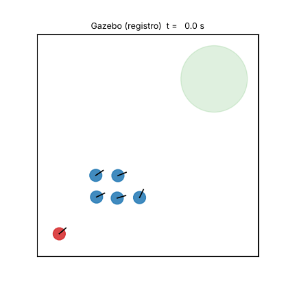
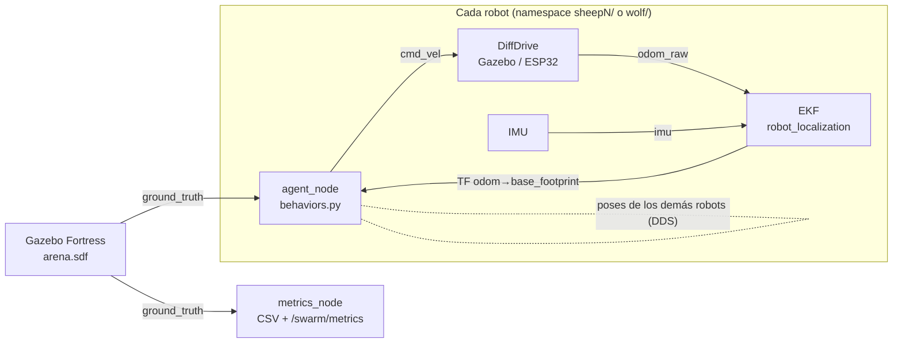

# Enjambre ovejas–lobo con el Yahboom MicroROS-Pi5

Gemelo digital del robot **Yahboom MicroROS-Pi5** (Raspberry Pi 5 + ESP32 micro-ROS, tracción 4WD skid-steer) en **ROS 2 Humble + Gazebo Fortress**. Incluye el modelado y control de los motores, el análisis y la corrección de la odometría, y un algoritmo de comportamiento colectivo **ovejas–lobo**: un robot "lobo" conduce a un rebaño de robots "ovejas" hasta un corral.



> **Estado del proyecto.** Este repositorio es una **reconstrucción** del Proyecto 07 a partir de la documentación y el código oficiales de Yahboom. Todos los resultados son de **simulación** (Python, MATLAB/Octave y Gazebo). Aún no hay medidas en los robots físicos. Los parámetros marcados como supuestos están listados en [docs/01_parametros.md](docs/01_parametros.md).

## Resultados principales

| Tema | Resultado | Dónde |
| --- | --- | --- |
| Cinemática | El firmware asume un factor de derrape χ = 1,704. La teoría (Coulomb isótropo) da χ = 1,495 y Gazebo mide 1,44–1,52. La odometría de ruedas sobrestima cada giro un ≈ 10 % | [docs/03](docs/03_cinematica.md) |
| Control del motor | PI por cancelación de polo: subida de 50 ms, sin sobreimpulso, margen de fase de 68° y margen de ganancia de 12 dB con el retardo del encoder | [docs/04](docs/04_motor_y_control.md) |
| Odometría (cuadrado de 1 m × 3 vueltas) | Solo encoders: 0,94 m de error. Encoders + giroscopo: 0,11 m. **EKF autocalibrado de 7 estados: 0,016 m (0,13 % del recorrido)** | [docs/05](docs/05_odometria.md) |
| Validación cruzada | El error de encoders + giroscopo es 0,110 m en Python, 0,109 m en MATLAB y 0,135 m en Gazebo | [docs/05](docs/05_odometria.md) |
| Pastoreo ovejas–lobo | 5 ovejas al corral en ≈ 41 s en Gazebo, sin colisiones, con 100 % de contención durante 60 s. Python (10 semillas): 100 % de éxito en 43,9 ± 3,4 s. Funciona también si cada robot solo usa su propia odometría | [docs/08](docs/08_experimentos.md) |
| Control del enjambre | Se diagnosticó y corrigió una oscilación del rumbo (≈ 150°/s → 2,4°/s) causada por fuerzas virtuales discontinuas y por rigidez × retardo | [docs/07](docs/07_ovejas_lobo.md) |

## Arquitectura



El control es **descentralizado**: cada robot ejecuta su propio `agent_node` y solo necesita las poses de los demás. Los tópicos (`cmd_vel`, `odom_raw`, `imu`, `scan`) son los mismos del robot real, así que el código del enjambre no cambia entre simulación y laboratorio.

## Estructura

| Carpeta | Contenido |
| --- | --- |
| `ros2_ws/src/microros_description` | URDF/xacro del MicroROS-Pi5 con mallas oficiales, plugins de Gazebo y RViz |
| `ros2_ws/src/microros_gazebo` | Arena 4 × 4 m con corral, lanzador de N robots, EKF |
| `ros2_ws/src/swarm_sheep_wolf` | Algoritmo ovejas–lobo, métricas, prueba de odometría, pruebas unitarias |
| `matlab/` | Cálculos en MATLAB/Octave (`m01`–`m04`) y modelos de Simulink y Simscape generados por script |
| `python/` | Modelo del robot, estimadores, experimentos de Monte Carlo y análisis de los registros de Gazebo |
| `docs/` | Documentación técnica detallada (00–08) y figuras |
| `data/` | CSV de todos los experimentos |

## Inicio rápido

Requisitos: Ubuntu 22.04, ROS 2 Humble y Gazebo Fortress.

```bash
sudo apt install ros-humble-desktop ros-humble-ros-gz ros-humble-xacro \
                 ros-humble-robot-localization ros-humble-teleop-twist-keyboard
cd ros2_ws
colcon build --symlink-install
source install/setup.bash

# 5 ovejas + 1 lobo pastor, con interfaz grafica y RViz
ros2 launch swarm_sheep_wolf demo.launch.py n_sheep:=5 gui:=true rviz:=true

# lobo cazador, usando la odometria de cada robot en vez del ground truth
ros2 launch swarm_sheep_wolf demo.launch.py wolf_mode:=hunt pose_source:=tf gui:=true
```

Simulaciones sin ROS:

```bash
pip install numpy matplotlib
python3 python/odometry_experiment.py          # odometria (docs/05)
python3 python/sim_sheep_wolf.py --all          # enjambre (docs/08)
```

MATLAB (o GNU Octave con el paquete `control`):

```matlab
cd matlab
run_all      % m01_cinematica, m02_motor_pid, m03_odometria, m04_ovejas_lobo
```

Pruebas unitarias (13): `python3 -m pytest ros2_ws/src/swarm_sheep_wolf/test`.

## Documentación

0. [Recursos oficiales de Yahboom](docs/00_recursos_oficiales.md)
1. [Parámetros del robot](docs/01_parametros.md)
2. [Gemelo digital en ROS 2 + Gazebo](docs/02_gemelo_digital.md)
3. [Cinemática skid-steer](docs/03_cinematica.md)
4. [Motor y lazo de velocidad](docs/04_motor_y_control.md)
5. [Odometría y EKF](docs/05_odometria.md)
6. [MATLAB, Simulink y Simscape](docs/06_matlab_simulink_simscape.md)
7. [Algoritmo ovejas–lobo](docs/07_ovejas_lobo.md)
8. [Experimentos y resultados](docs/08_experimentos.md)

## Créditos y licencia

- Robot, mallas STL, URDF original y firmware: [Yahboom Technology](https://github.com/YahboomTechnology/MicroROS-Car-Pi5). Las mallas se redistribuyen sin modificar.
- Pastoreo basado en Strömbom et al. (2014), *J. R. Soc. Interface* 11: 20140719. Reglas de enjambre de Reynolds (1987).
- Código de este repositorio: licencia MIT (ver [LICENSE](LICENSE)).
