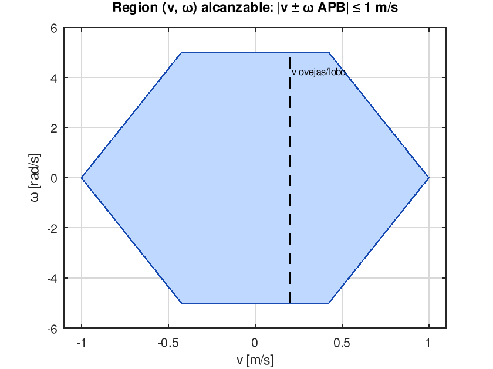

# 3. Cinemática del MicroROS-Pi5 (4WD skid-steer)

Script: `matlab/m01_cinematica.m`, verificado en GNU Octave 8.4.

## 3.1 Modelo del firmware (Yahboom, `car_motion`)

Motores: M1 izquierda-delante, M2 izquierda-detrás, M3 derecha-delante, M4 derecha-detrás.

**Inversa** (`Motion_Ctrl`), con *v* en m/s y ω en rad/s:

$$v_{M1}=v_{M2}=v-\omega\,(A+B),\qquad v_{M3}=v_{M4}=v+\omega\,(A+B)$$

En forma matricial:

$$\begin{bmatrix}v_{M1}\\v_{M2}\\v_{M3}\\v_{M4}\end{bmatrix}=\underbrace{\begin{bmatrix}1&-APB\\1&-APB\\1&APB\\1&APB\end{bmatrix}}_{J_{inv}}\begin{bmatrix}v\\\omega\end{bmatrix}$$

**Directa** (`Motion_Get_Speed`), usada para `odom_raw`:

$$v=\tfrac14\sum_i v_{Mi},\qquad \omega=\frac{-(v_{M1}+v_{M2})+(v_{M3}+v_{M4})}{4\,APB}$$

El script comprueba numéricamente que $J_{dir}J_{inv}=I_2$.

## 3.2 Trocha efectiva y derrape (skid-steer)

En un diferencial ideal $\omega=(v_R-v_L)/W$. Un 4WD sin dirección tiene que **derrapar lateralmente** para girar, y gira menos de lo que indican las ruedas:

$$\omega=\frac{v_R-v_L}{\chi\,W},\qquad \chi\ge1$$

El firmware usa implícitamente $\chi_{fw}=2\,APB/W=2(A+B)/2A=1+L/W=\mathbf{1{,}704}$.

**Deducción de χ con fricción de Coulomb isótropa** (giro en el sitio, carga igual en las 4 ruedas). La rueda en $(x_i,y_i)=(\pm B,\pm A)$ gira con velocidad superficial $\pm u$. La velocidad de deslizamiento es

$$\mathbf s_i=\boldsymbol\omega\times\mathbf r_i-u_i\hat x=(-\omega y_i-u_i,\ \omega x_i)$$

La fuerza de fricción vale $\mathbf F_i=-\mu N\,\mathbf s_i/|\mathbf s_i|$. Por simetría, todas las $|\mathbf s_i|$ son iguales. El equilibrio de momentos $\sum (x_iF_{y,i}-y_iF_{x,i})=0$ da

$$\omega\,(A^2+B^2)=A\,u\quad\Rightarrow\quad \chi=\frac{A^2+B^2}{A^2}=1+\left(\frac{L}{W}\right)^2=\mathbf{1{,}495}$$

| Fuente | χ |
| --- | --- |
| Supuesto del firmware | 1,704 |
| Teoría (Coulomb isótropo) | 1,495 |
| Gazebo Fortress, giro en el sitio a 1 rad/s | **1,52** |
| Gazebo Fortress, cuadrado de 3 vueltas | **1,44** |
| Valor usado en las simulaciones de Python y MATLAB | 1,55 ± 4 % |

**Consecuencia:** la odometría de ruedas sobrestima cada giro en $\chi_{fw}/\chi\approx1{,}10$, es decir, un 10 %. En un cuadrado de 3 vueltas, con 12 giros de 90°, el error acumulado ronda los 100° de rumbo (sección 5).

## 3.3 Región alcanzable

Con $|v_{Mi}|\le1$ m/s: $|v|+|\omega|\,APB\le1$. El giro en el sitio podría llegar a 8,7 rad/s, pero el firmware lo limita a 5 rad/s.

## 3.4 Ejemplo resuelto: v = 0,20 m/s, ω = 1,0 rad/s

| | M1, M2 (izquierda) | M3, M4 (derecha) |
| --- | --- | --- |
| Velocidad lineal: $0{,}2\mp1{,}0\cdot0{,}115$ | 0,085 m/s | 0,315 m/s |
| Rueda: $v/r\cdot60/2\pi$ | 33,8 rpm | 125,3 rpm |
| Cuentas en 10 ms: $v/(2\pi r)\cdot1040\cdot0{,}01$ | 5,86 | 21,7 |

La resolución de velocidad del encoder en una ventana de 10 ms es $2\pi r/1040/0{,}01=\mathbf{0{,}0145}$ m/s por cuenta. A 0,2 m/s hay unas 14 cuentas por periodo, así que la medida de velocidad tiene un error de cuantización de alrededor del 7 % por muestra. El PID lo filtra al integrar.
