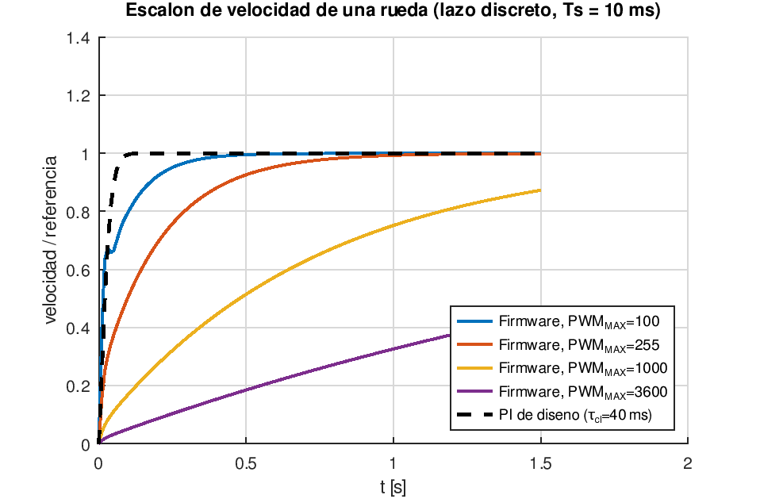
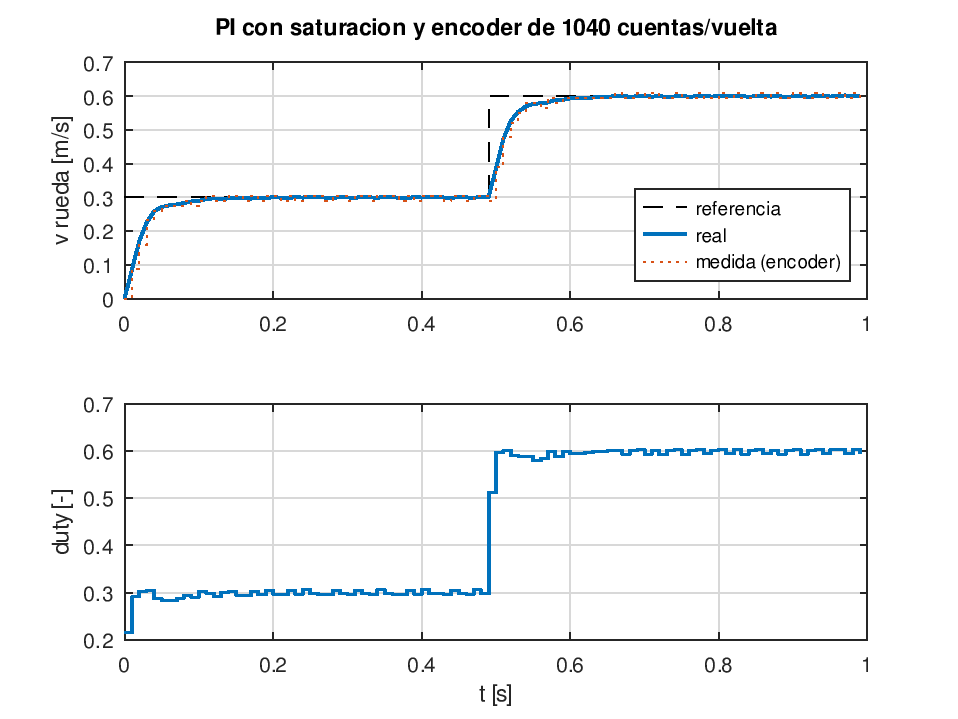

# 4. Motor 310 y lazo de velocidad del ESP32

Scripts:
- `matlab/m02_motor_pid.m`: cálculo y análisis, verificado en Octave 8.4.
- `matlab/simulink/build_rueda_pid.m`: modelo de Simulink generado por script.
- `matlab/simscape/build_simscape_motor.m`: modelo físico en Simscape.

## 4.1 Modelo electromecánico

$$L_a\frac{di}{dt}=V-R\,i-K_e\,\omega_m,\qquad J\frac{d\omega_m}{dt}=K_t\,i-b\,\omega_m$$

$$G_m(s)=\frac{\omega_m(s)}{V(s)}=\frac{K_t}{(L_a s+R)(J s+b)+K_tK_e}$$

$K_e=K_t=V_{bat}/(\omega_{nl}N)=7{,}4/(41{,}9\cdot20)=8{,}83\cdot10^{-3}$ V·s/rad. Este valor sale del supuesto de 400 rpm en vacío a la salida de la reductora.

**Inercia equivalente en el eje del motor.** Cada motor mueve 1/4 de la masa del robot:

| Término | Expresión | Valor [kg·m²] |
| --- | --- | --- |
| Rotor | $J_m$ | 1,00·10⁻⁷ |
| Robot | $\tfrac{m}{4}\,r^2/N^2=0{,}325\cdot0{,}024^2/400$ | 4,68·10⁻⁷ |
| Rueda | $\tfrac12 m_w r^2/N^2$ | 0,22·10⁻⁷ |
| **Total *J*** | | **5,90·10⁻⁷** |

Constantes de tiempo:

- Eléctrica: $\tau_e=L_a/R=0{,}40$ ms.
- Mecánica: $\tau_m=JR/(K_tK_e+Rb)=18{,}8$ ms.

Como $\tau_e\ll\tau_m$, la planta es de primer orden en la práctica.

Planta de control, de duty *d* ∈ [−1, 1] a velocidad lineal de rueda:

$$G_p(s)=V_{bat}\,G_m(s)\,\frac{r}{N}\approx\frac{K}{\tau_m s+1},\qquad K=1{,}00\ \text{m/s}$$

## 4.2 Diseño del PI por cancelación de polo

$C(s)=K_p+K_i/s$ con $K_i/K_p=1/\tau_m$, de modo que el lazo abierto queda $L(s)=K_pK/(\tau_m s)$ y el lazo cerrado es de primer orden con $\tau_{cl}=\tau_m/(K_pK)$.

Se elige **τcl = 40 ms**, unas 4 veces Ts, para dejar margen al retardo del encoder:

$$K_p=\frac{\tau_m}{K\,\tau_{cl}}=\mathbf{0{,}470}\ \tfrac{\text{duty}}{\text{m/s}},\qquad K_i=\frac{K_p}{\tau_m}=\mathbf{24{,}9}\ \tfrac{\text{duty}}{\text{m}}$$

Discretización Tustin con Ts = 10 ms, más **un retardo de una muestra**, porque el encoder mide la velocidad media del periodo anterior.

| Métrica (lazo discreto con retardo) | Valor |
| --- | --- |
| Margen de fase | **68°** a ωc = 25 rad/s |
| Margen de ganancia | **12 dB** a 103 rad/s |
| Tiempo de subida (10–90 %) | 50 ms |
| Sobreimpulso | 0 % |
| Establecimiento (2 %) | 80 ms |

La constante equivalente del lazo cerrado, ≈ 23 ms, es la que usa el simulador de Python (`robot_model.MicroRosRobot.tau = 25 ms`).

## 4.3 Análisis del PID incremental del firmware de Yahboom

$$\Delta u_k=K_p(e_k-e_{k-1})+K_i\,e_k+K_d(e_k-2e_{k-1}+e_{k-2}),\qquad K_p=1,\ K_i=0{,}2,\ K_d=0{,}2$$

En este PID, *e* está en **cuentas por 10 ms** (1 m/s = 69 cuentas) y *u* en **unidades PWM**, saturado en `PWM_MOTOR_MAX_VALUE`. Ese valor no aparece en los tutoriales, así que se hizo un barrido:

| PWM_MAX | máx. \|polo\| en lazo cerrado | Valor alcanzado a 1,5 s |
| --- | --- | --- |
| 100 | 0,909 | 1,000 |
| 255 | 0,954 | 0,999 |
| 1000 | 0,987 | 0,873 |
| 3600 | 0,996 | 0,443 |

**Lectura:** con las ganancias de fábrica, el lazo es estable para cualquier escala de PWM. Pero si el PWM tiene mucha resolución (≥ 1000), la respuesta es **lenta**, con constante de tiempo de centenares de milisegundos. Por eso conviene leer `PWM_MOTOR_MAX_VALUE` del código del ESP32 o ajustar las ganancias con el diseño de 4.2.

## 4.4 Efectos no lineales

`m02` simula la saturación del duty (±1), el anti-windup por integración condicional y la cuantización real del encoder (cuentas enteras por periodo).

## 4.5 Identificación en el robot real

1. Levantar el robot y aplicar un escalón de PWM al 50 % en una rueda. Registrar las cuentas cada 10 ms (`Encoder_Get_Count`).
2. Ajustar un primer orden $K/(\tau s+1)$ a la curva de velocidad. Es una regresión de mínimos cuadrados sobre $\ln(1-v/v_\infty)$.
3. Repetir con el robot apoyado en el suelo, para tener la carga real.
4. Sustituir *K* y τ en `params_microros.m` y volver a ejecutar `m02` y `build_rueda_pid`.
