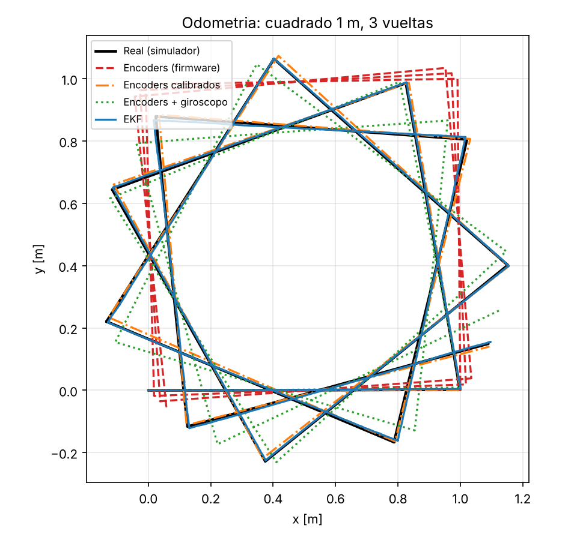
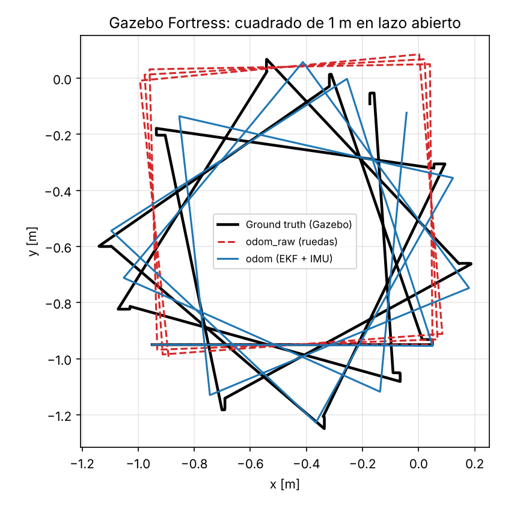

# 5. Odometría y estimación de estado

Scripts:
- `python/robot_model.py` (modelo y estimadores)
- `python/odometry_experiment.py`
- `matlab/m03_odometria.m`
- `ros2_ws/.../odom_test_node.py` (Gazebo)
- `python/analyze_gazebo_odom.py`

## 5.1 Cadena de medida del robot real

```
encoders (1040 cpr, 10 ms) ──► ESP32: cinemática directa (APB) ──► odom_raw ─┐
IMU del ESP32 ──► imu ──► imu_filter_madgwick ──► imu/data ───────────────────┴─► EKF ─► odom
```

## 5.2 Fuentes de error modeladas

| Fuente | Modelo | Efecto |
| --- | --- | --- |
| Derrape en el giro (skid-steer) | ω real = (v<sub>R</sub> − v<sub>L</sub>)/(χW), con χ = 1,55 ± 4 % según el suelo | La odometría de ruedas sobrestima cada giro un $\chi_{fw}/\chi-1\approx10\%$ |
| Deslizamiento longitudinal | ruido blanco del 2 % por rueda y paso | Error aleatorio pequeño en la distancia |
| Cuantización del encoder | cuentas enteras, 0,145 mm por cuenta | Despreciable en la pose |
| Giroscopo | sesgo de 0,002 rad/s y ruido de 0,005 rad/s | Deriva de rumbo de ≈ 0,11°/s |

## 5.3 Estimadores comparados

| Id | Estimador | Descripción |
| --- | --- | --- |
| **E** | Solo encoders | Exactamente lo que publica `odom_raw` del ESP32 |
| **Ec** | Encoders calibrados | Escalas lineal y angular obtenidas con el procedimiento de Yahboom (`calibrate_linear`/`calibrate_angular`) en un suelo nominal |
| **EG** | Encoders + giroscopo | *v* de las ruedas y ω de la IMU. Es lo que hace `robot_localization` con `ekf.yaml` |
| **EKF** | EKF de 7 estados (propio) | $[x,y,\theta,v,\omega,b_g,k_\omega]$ con $\omega_{enc}=k_\omega\,\omega$ y $gyro=\omega+b_g$. Estima en línea el sesgo del giroscopo **y** el factor de derrape |

Modelos de medida del EKF:

$$h(\mathbf x)=\begin{bmatrix}v\\k_\omega\,\omega\\\omega+b_g\end{bmatrix},\qquad H=\begin{bmatrix}0&0&0&1&0&0&0\\0&0&0&0&k_\omega&0&\omega\\0&0&0&0&1&1&0\end{bmatrix}$$

**Observabilidad.** Cuando ω = 0, la diferencia gyro − 0 observa $b_g$. Al girar, la diferencia entre $\omega_{enc}$ y gyro observa $k_\omega$. Por eso los dos estados convergen en una trayectoria que alterna rectas y giros. La covarianza se actualiza en forma de Joseph.

## 5.4 Calibración tipo Yahboom (simulada)

El procedimiento de `calibrate_angular` da **scale_ang = 1,0992**, igual al valor teórico $\chi_{fw}/\chi=1{,}704/1{,}55=1{,}0992$. Esto valida el modelo. `scale_lin` da 1,0004.

## 5.5 Resultados: cuadrado de 1 m × 3 vueltas (12 m, ~86 s)

**Python**, 20 ensayos con χ distinto en cada uno:

| Estimador | Error final de posición | % del recorrido | Error de rumbo |
| --- | --- | --- | --- |
| E: encoders (firmware) | 0,94 ± 0,30 m | 7,8 % | 106 ± 48° |
| Ec: encoders calibrados | 0,48 ± 0,30 m | 4,0 % | 50 ± 33° |
| EG: encoders + giroscopo | 0,110 ± 0,006 m | 0,9 % | 9,9 ± 0,3° |
| **EKF autocalibrado** | **0,016 ± 0,010 m** | **0,13 %** | **1,5 ± 0,9°** |

**Validación cruzada con tres herramientas independientes:**

| Estimador | Python | MATLAB/Octave (`m03`) | Gazebo Fortress (física DART) |
| --- | --- | --- | --- |
| Solo encoders | 0,94 m | 0,98 m | 1,16 m (χ medido = 1,44) |
| Encoders + giroscopo | 0,110 m / 9,9° | 0,109 m / 9,9° | 0,135 m / 9,9° |

Las tres coinciden. El error residual del estimador encoders + giroscopo es casi exactamente la **deriva del sesgo del giroscopo**: 0,002 rad/s × 86 s = 9,9°.




## 5.6 Conclusiones para el enjambre

1. **No usar solo `odom_raw` para el rumbo.** En un 4WD skid-steer, el error de giro domina: unos 100° en 12 m.
2. **La calibración de Yahboom sirve en un solo suelo.** Si el suelo o la batería cambian χ un 4 %, el error vuelve a 0,5 m.
3. **Hay que fusionar el giroscopo.** Así se pasa a ≈ 1 % del recorrido, limitado por el sesgo. Basta con estimar el sesgo 2 s con el robot parado antes de cada ensayo.
4. **El EKF autocalibrado** (sesgo + factor de derrape) baja a 0,13 % del recorrido. Es el candidato para sustituir a `robot_localization` en una iteración futura, como nodo ROS 2 propio.
