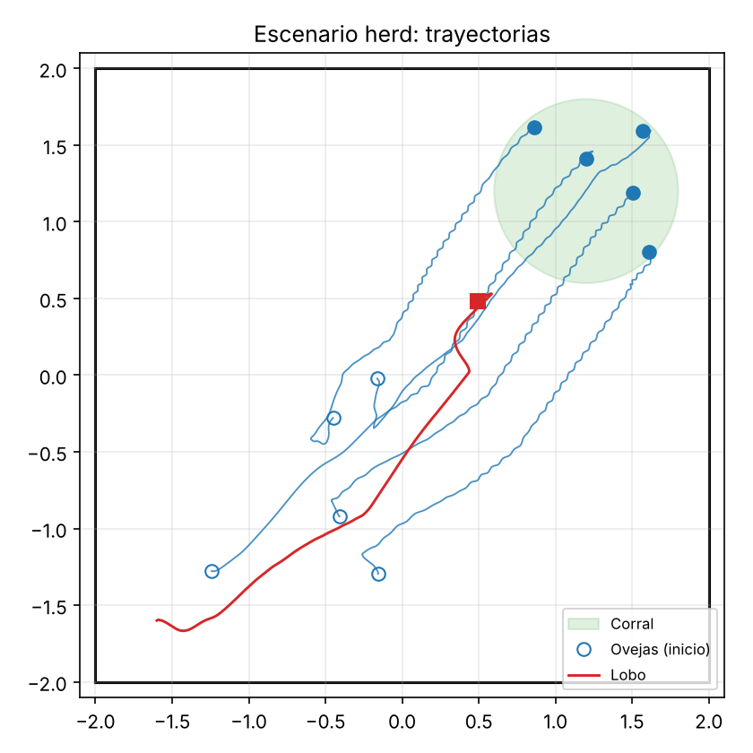
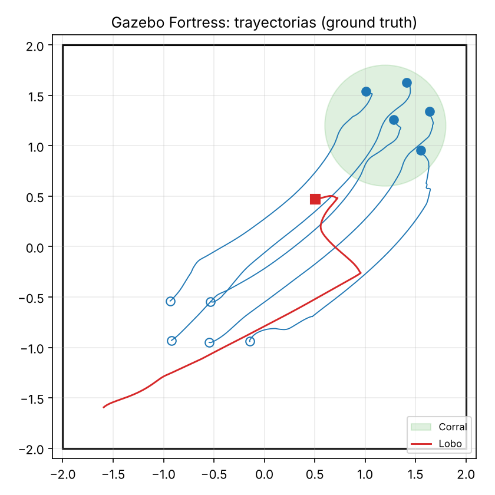
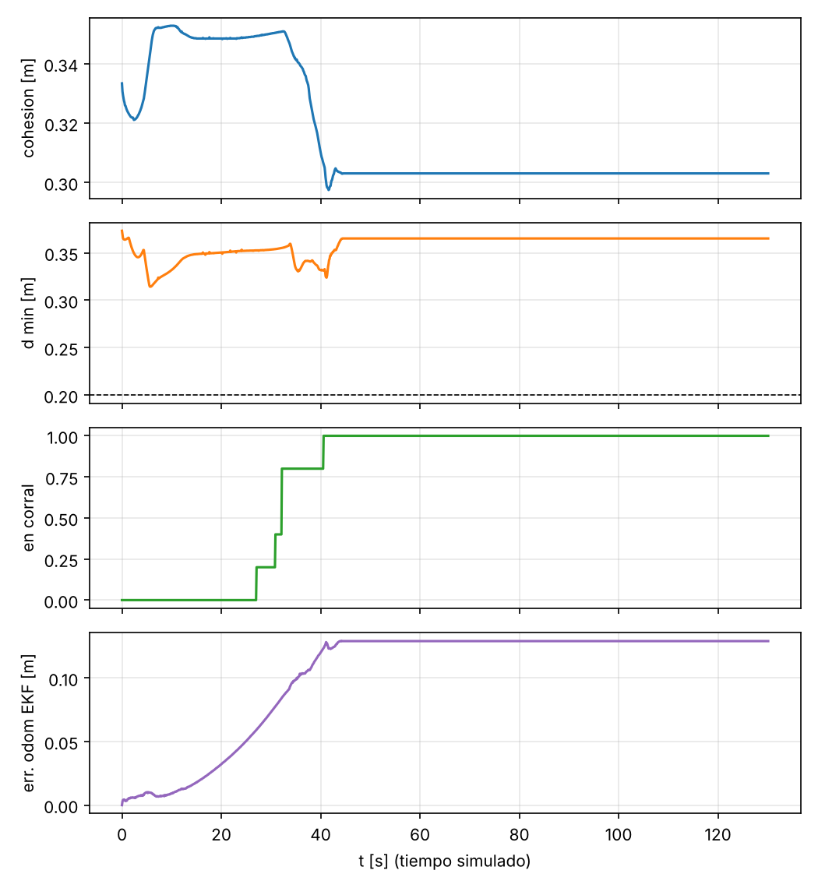

# 8. Experimentos y resultados

Todos los resultados son de **simulación**. Cada experimento se repite con tres herramientas independientes cuando es posible:

| Herramienta | Modelo del robot | Para qué sirve |
| --- | --- | --- |
| Python (`python/`) | Cinemática del firmware, lazo de rueda de 25 ms, derrape χ, encoders cuantizados, giroscopo con sesgo, retardo de actuación de 100 ms | Monte Carlo rápido (10–20 semillas) |
| MATLAB/Octave (`matlab/`) | Uniciclo con los límites del firmware y lazo de 25 ms | Verificación independiente de la ley de control |
| Gazebo Fortress (`ros2_ws/`) | Física DART con contactos de rueda, plugins DiffDrive/IMU, EKF de `robot_localization`, nodos ROS 2 reales | Gemelo digital: el mismo código que irá al robot |

Los CSV están en `data/` y las figuras en `docs/figures/`.

## 8.1 Odometría (cuadrado de 1 m × 3 vueltas)

Detalle en [05_odometria.md](05_odometria.md).

| Estimador | Python (20 ensayos) | MATLAB | Gazebo |
| --- | --- | --- | --- |
| Solo encoders | 0,94 ± 0,30 m | 0,98 ± 0,23 m | 1,16 m |
| Encoders calibrados (Yahboom) | 0,48 ± 0,30 m | | |
| Encoders + giroscopo | 0,110 ± 0,006 m | 0,109 ± 0,005 m | 0,135 m |
| EKF autocalibrado (7 estados) | **0,016 ± 0,010 m** | | |

## 8.2 Enjambre en Python (10 semillas por fila)

`python3 python/sim_sheep_wolf.py --all` → `data/swarm_summary.csv`

| Escenario | Percepción | Éxito | Tiempo [s] | Colisiones | Cohesión [m] | d<sub>min</sub> [m] | Contención | Giro medio [°/s] |
| --- | --- | --- | --- | --- | --- | --- | --- | --- |
| Rebaño sin lobo | real | – | – | 0 | 0,32 | 0,356 | – | 6 |
| Rebaño sin lobo | odometría | – | – | 0 | 0,32 | 0,356 | – | 7 |
| **Pastoreo** | real | **100 %** | 43,9 ± 3,4 | 0 | 0,35 | 0,287 | 99,9 % | 30 |
| **Pastoreo** | odometría EKF | **100 %** | 47,5 ± 2,4 | 0 | 0,36 | 0,288 | 97,8 % | 43 |
| Caza | real | 100 % | 10,3 ± 0,8 | 0 | 0,38 | 0,216 | – | 39 |
| Caza | odometría EKF | 100 % | 10,2 ± 0,7 | 0 | 0,38 | 0,216 | – | 41 |

- *Éxito*: todas las ovejas en el corral (pastoreo) o el lobo a menos de 0,22 m de una oveja (caza), antes de 220 s.
- *Contención*: fracción media de ovejas dentro del corral en los 60 s siguientes, con el lobo de guardia.
- *Percepción odometría*: cada robot usa la pose de su propio EKF, no la real. Es el caso del laboratorio sin captura de movimiento. El pastoreo sigue funcionando porque el error del EKF (≈ 1 cm en 50 s) es mucho menor que las distancias entre robots.
- El giro medio en Python es mayor que en Gazebo porque el simulador usa un retardo puro de 100 ms, que es conservador (sección 7.6).



## 8.3 Enjambre en Gazebo Fortress (gemelo digital, 5 ovejas + 1 lobo)

```bash
ros2 launch swarm_sheep_wolf demo.launch.py n_sheep:=5 wolf_mode:=herd pose_source:=ground_truth duration:=130 output:=data/gazebo_swarm_herd_gt.csv
python3 python/analyze_gazebo_swarm.py data/gazebo_swarm_herd_gt.csv --tag gazebo_herd --gif
```

| Ensayo | Llegada al corral | Colisiones | d<sub>min</sub> [m] | Contención (60 s) | Giro medio [°/s] | Error EKF final [m] |
| --- | --- | --- | --- | --- | --- | --- |
| Pastoreo, poses reales (`ground_truth`) | **40,6 s** | 0 | 0,314 | 100 % | 2,4 | 0,13 |
| Pastoreo, poses de odometría (`tf`) | **43,8 s** | 0 | 0,265 | 100 % | 4,4 | 0,11 |
| Caza, poses reales | captura a 6,5 s | 0 entre ovejas* | 0,247 entre ovejas | – | 13 | 0,13 |

\* El registro cuenta 1 contacto: es la captura (lobo y oveja a 0,16 m), no un choque entre ovejas.

El tiempo de caza en Gazebo (6,5 s) es menor que en Python (10,3 s) porque las posiciones iniciales son distintas: en Gazebo las ovejas parten en una rejilla fija, y en Python en posiciones aleatorias.

Con `pose_source:=tf` cada robot se guía solo por su EKF a bordo (encoders + IMU). Es la prueba más cercana al laboratorio sin captura de movimiento, y el pastoreo funciona igual.




## 8.4 Comparación entre herramientas (pastoreo)

| | Python (10 semillas) | MATLAB (1 semilla) | Gazebo (`ground_truth`) | Gazebo (`tf`) |
| --- | --- | --- | --- | --- |
| Llegada al corral | 43,9 ± 3,4 s | 39,7 s | 40,6 s | 43,8 s |
| Distancia mínima | 0,287 m | 0,298 m | 0,314 m | 0,265 m |
| Contención | 99,9 % | 100 % | 100 % | 100 % |
| Colisiones | 0 | 0 | 0 | 0 |

Las tres herramientas coinciden en ±10 %, a pesar de que Gazebo resuelve la física de contacto de las ruedas y Python/MATLAB usan un modelo cinemático. Eso indica que el modelo cinemático + lazo de 25 ms + retardo captura lo esencial del robot para el diseño del comportamiento.

## 8.5 Historia de las correcciones

Los resultados de arriba son de la versión final. Las versiones intermedias están descritas en [07_ovejas_lobo.md](07_ovejas_lobo.md) (secciones 7.3 y 7.6):

| Versión | Resultado en Gazebo | Cambio para la siguiente |
| --- | --- | --- |
| 1 | Llegada a 93 s, pero después el lobo cruzaba el corral hacia la esquina: quedó el 40 % dentro y hubo 1 contacto | Modo vigilancia y conducción desde el lado abierto |
| 2 | Contención del 99 %, pero el rumbo de las ovejas oscilaba a ≈ 156°/s | Separación continua |
| 3 | Python ya no oscila; Gazebo sigue a ≈ 142°/s | Zona muerta y velocidades por diferencias de posición |
| 4 | ≈ 123–126°/s, sobre todo con el rebaño parado en el corral | Marcha atrás en ajustes lentos |
| 5 | ≈ 110°/s. Se reproduce en Python con 100 ms de retardo: es rigidez × retardo | Separación promediada |
| 6 (final) | **2,4°/s**, 0 colisiones, contención del 100 % | |

Además, en la versión 6 se corrigió la métrica de error de odometría de `metrics_node`, que no tenía en cuenta el rumbo inicial del EKF. Los valores de error de odometría de las versiones 1–5 (0,2–1,7 m) no son fiables; los de las tablas de arriba sí.

## 8.6 Pendiente para el robot físico

1. Medir los parámetros marcados **SUP** ([00_recursos_oficiales.md](00_recursos_oficiales.md), sección 0.4).
2. Medir el retardo real entre `cmd_vel` y el movimiento de las ruedas (micro-ROS por WiFi). Si supera los 100 ms, revisar $w_{sep}$ y $k_h$ con el criterio de la sección 7.6.
3. Repetir la prueba del cuadrado con `odom_test_node` y comparar con la tabla 8.1.
4. Ejecutar el enjambre con `pose_source:=tf` y, si es posible, con una cámara cenital como referencia.
